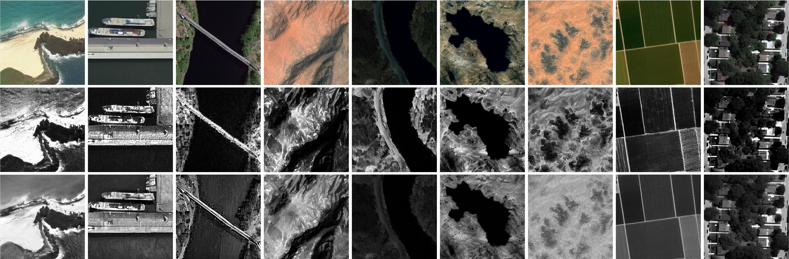
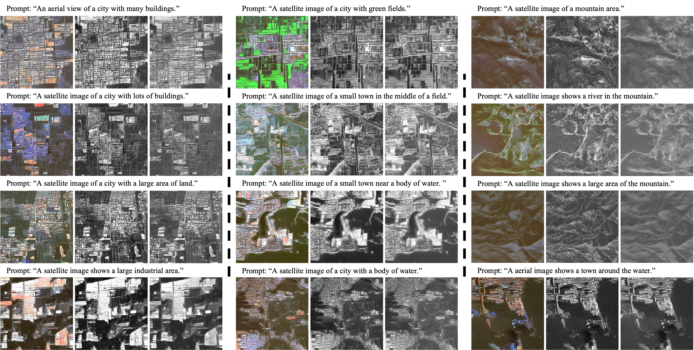
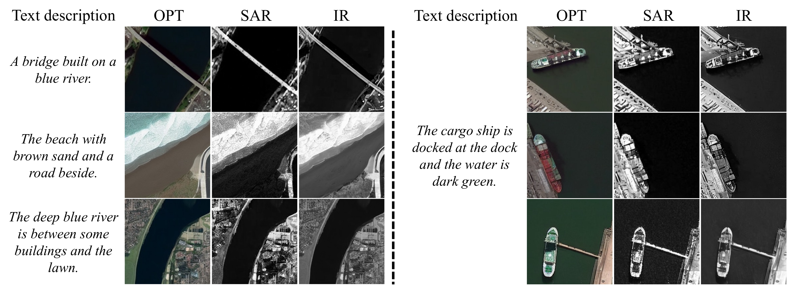
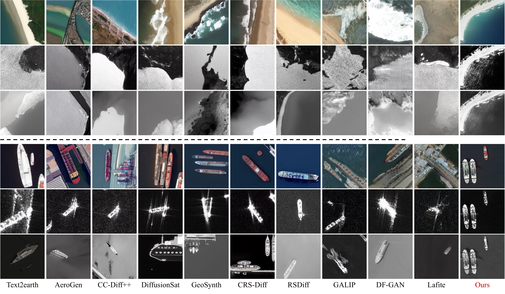
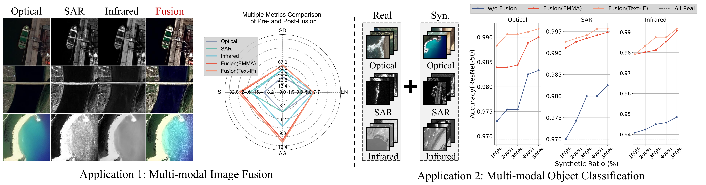

<div align="center">


# MMDiff: Multi-modal Remote Sensing Image Generation via Cross-Modality Spatial Feature Transfer

<div  align="center" style="margin-top:10px;"> 

<p><span style="font-size: 26px;"><strong>ISPRS 2026 &#128293;</strong></span></p>
<div align="center">

**Haojun Tang**<sup>1</sup> · **Wenda Zhao**<sup>1,*</sup> · **Hengshuai Cui**<sup>1</sup> · **Haipeng Wang**<sup>2</sup>

<sup>1</sup> Dalian University of Technology  
<sup>2</sup> Unit 92728 of PLA

</div>

<div align="center">

[](#)
[](#)

</div>

<div align="center">

[](https://huggingface.co/XinRan-Tang/MMDiff-WHU)
[](https://huggingface.co/XinRan-Tang/MM-Diff)
[](https://huggingface.co/datasets/XinRan-Tang/MMDiff-WHU-dataset)
[](https://huggingface.co/datasets/XinRan-Tang/Optical-SAR-Infrared)

</div>

<sup>*</sup> **Corresponding author:**

</div>


## Abstract

<div align="justify">

Collecting spatially consistent multi-modal remote sensing (MMRS) images remains challenging due to different sensors vary in the imaging principles and acquisition times. This hinders the development of data-driven MMRS technologies, which rely on large-scale training samples. This paper proposes MMDiff, the first text-driven diffusion framework explicitly designed for jointly generating structurally consistent optical (OPT), synthetic aperture radar (SAR), and infrared (IR) remote sensing images from a single text prompt via cross-modality spatial feature transfer. MMDiff first trains the OPT branch with paired optical image-text data to capture rich semantic content, and then trains the SAR/IR branches with simple modality-specific text templates to learn the corresponding style attributes, without relying on complex linguistic descriptions. Specifically, we introduce a LoRA-based modality translation adaptation mechanism to translate the style attributes of optical spatial representations to SAR and IR style attributes while preserving the underlying semantic content. The translated representations are then transferred into the SAR and IR generation branches through the proposed spatial feature transfer mechanism, enabling rich spatial details in the generated SAR/IR images while maintaining cross-modal spatial consistency. Extensive experiments demonstrate that MMDiff achieves superior image quality in terms of modality similarity and semantic consistency compared to the state-of-the-art methods. Furthermore, MMDiff benefits downstream data-driven MMRS applications, e.g., multi-modal image fusion and object classification.

</div>

<p align="center"></p>
<p align="center" style="margin-top: -10px;"><span style="color: gray; font-size: 14px;">From top to bottom: optical (OPT), synthetic aperture radar (SAR), and infrared (IR) images generated on the Optical-SAR-Infrared (OSI) dataset.</span></p>

<div align="left">

## 📢 &nbsp; Latest Updates

- **2026-10-30** — We released MMDiff results on **WHU-OPT-SAR**; the model and dataset are now available 🔥
- **2026-09-12** — Training code is now available 🎉 !
- **2026-08-25** — Dataset and model are available on Hugging Face 🎊 ！
- **2026-08-25** — Sampling code is now available 🎉 !
- **2026-08-15** — Our paper has been accepted by **ISPRS 2026**  🎉 🎉 🎉 !!! 


## ✨ &nbsp; News

<div align="justify">

We release **MMDiff-WHU**, a new version of **MMDiff** fine-tuned on **MMDiff-WHU-dataset**, which is derived from the **WHU-OPT-SAR** dataset. **WHU-OPT-SAR** is a multi-modal remote sensing land-cover dataset from Wuhan University. We cropped its imagery into **512×512** tiles and assigned each tile to the semantic class occupying the largest area in its segmentation mask (i.e., a majority vote by area). The original dataset contains seven land-cover classes; we retain four—**city**, **farmland**, **forest**, and **water**—by merging city and village into a single category and excluding road, others, and background. Each tile was then captioned with GPT-4o-mini, yielding paired optical (OPT), synthetic aperture radar (SAR), near-infrared (NIR), and text data. The OPT branch was fine-tuned on all four classes, while the SAR and NIR branches were fine-tuned with class-specific LoRA adapters.

See [MMDiff-WHU](https://huggingface.co/XinRan-Tang/MMDiff-WHU) for the model checkpoints and [MMDiff-WHU-dataset](https://huggingface.co/datasets/XinRan-Tang/MMDiff-WHU-dataset) for the dataset.

</div>

<p align="center"></p>
<p align="center" style="margin-top: -10px;"><span style="color: gray; font-size: 14px;">For each group, from left to right: optical (OPT), synthetic aperture radar (SAR), and near-infrared (NIR) images generated by the MMDiff model fine-tuned on WHU-OPT-SAR.</span></p>

## 📊 &nbsp; Main Results

### 1️⃣ &nbsp; Text-to-spatially-consistent Optical, Synthetic Aperture Radar, and Infrared Generation

<p align="center"></p>

### 2️⃣ &nbsp; Comparison with Existing Methods

<p align="center"></p>

### 3️⃣ &nbsp; Downstream Tasks

<p align="center"></p>

## 🚀 Quick Start

### 🛠️ Installation

Create and activate a Conda environment, then install the required packages:

```bash
git clone https://github.com/XinR-Tang/MMDiff
cd MMDiff

conda create -n mmdiff python=3.10 -y
conda activate mmdiff
pip install -r requirements.txt
```

### 📦 Model Placement

Download the model files from [MMDiff](https://huggingface.co/XinRan-Tang/MM-Diff) and [MMDiff-WHU](https://huggingface.co/XinRan-Tang/MMDiff-WHU) and place them under `models/` in the project root. The expected layout is:

```text
MMDiff/
└── models/
    ├── MMDiff/
    │   ├── mmdiff-opt/
    │   ├── mmdiff-sar/
    │   └── mmdiff-ir/
    └── MMDiff-WHU/
        ├── mmdiff-opt/
        ├── mmdiff-sar/
        └── mmdiff-ir/
```

### 🛠️ Sampling

All inference parameters are configured in [`mmdiff/config.py`](mmdiff/config.py). Before sampling, set the prompt, seed, output name, device, and model paths in `SamplingConfig`. By default, the model paths point to:

```text
./models/MMDiff/mmdiff-opt
./models/MMDiff/mmdiff-sar/sd-sar-lora-ship
./models/MMDiff/mmdiff-ir/sd-ir-lora-ship
```

The OPT pipeline automatically saves its spatial features to `./features/visible_attn_maps/` and `./features/visible_resnet_maps/`. The subsequent SAR and IR pipelines read these two directories, so keep them available until all three modalities have been generated. You can change both locations through `attn_path` and `resnet_path` in `SamplingConfig`.

Then activate the environment and run the three-modality sampling pipeline:

```bash
cd /path/to/MMDiff
conda activate mmdiff
PYTHON="$CONDA_PREFIX/bin/python" bash scripts/sampling.sh
```

Generated OPT, SAR, and IR images are saved under `result/opt/`, `result/sar/`, and `result/ir/`, respectively.

To sample with the WHU-OPT-SAR fine-tuned model at 512×512 resolution, use [`scripts/sampling_whu.sh`](scripts/sampling_whu.sh):

```bash
PROMPT="a satellite image shows the city area with water." bash scripts/sampling_whu.sh
```

### 🏋️ Training

Train the three branches in order: **OPT → SAR → IR**. The OPT branch is first trained on all optical categories, then the SAR and IR LoRA branches are trained from the resulting OPT model. SAR and IR can be trained for any of the following nine categories: `beach`, `bridge`, `desert`, `farmland`, `lake`, `mountain`, `residential`, `river`, and `ship`. The default category is `ship`; set `CATEGORY` to train another category.

Before training, update `project_root` in `scripts/train_opt.sh`, `scripts/train_sar.sh`, and `scripts/train_ir.sh` to your local MMDiff directory. Also ensure that `optical_sar_infrared_data_dir` in `mmdiff/config.py` points to the Optical-SAR-Infrared dataset. By default, trained checkpoints are saved under `model-v1/`.

```bash
cd /path/to/MMDiff
conda activate mmdiff

# 1. Train the OPT branch.
bash scripts/train_opt.sh

# 2. Train the SAR LoRA branch.
bash scripts/train_sar.sh

# 3. Train the IR LoRA branch.
bash scripts/train_ir.sh
```

After training, run the complete OPT → SAR → IR sampling pipeline with the generated checkpoints:

```bash
bash scripts/sampling.sh \
  --model_path path/to/model-v1/mmdiff-opt \
  --sar_lora_path path/to/model-v1/mmdiff-sar/sd-sar-lora-ship \
  --ir_lora_path path/to/model-v1/mmdiff-ir/sd-ir-lora-ship
```

To train on the WHU-OPT-SAR dataset, use the WHU training scripts. The OPT branch is fine-tuned on all four categories (`city`, `farmland`, `forest`, `water`) at 512×512 resolution, and the SAR and IR branches are fine-tuned with category-specific LoRA adapters:

```bash
cd /path/to/MMDiff
conda activate mmdiff

# 1. Train the OPT branch on WHU-OPT-SAR.
bash scripts/train_whu_opt.sh

# 2. Train the SAR LoRA branches (city, farmland, forest, water).
bash scripts/train_whu_sar.sh

# 3. Train the IR LoRA branches (city, farmland, forest, water).
bash scripts/train_whu_ir.sh
```

## 📚 &nbsp; Citation

If you find MMDiff useful, please cite:

```bibtex
@article{tang2026mmdiff,
  title={MMDiff: Multi-modal remote sensing image generation via cross-modality spatial feature transfer},
  author={Tang, Haojun and Zhao, Wenda and Cui, Hengshuai and Wang, Haipeng},
  journal={ISPRS Journal of Photogrammetry and Remote Sensing},
  volume={241},
  pages={93--108},
  year={2026},
  publisher={Elsevier}
}
```
</div>
